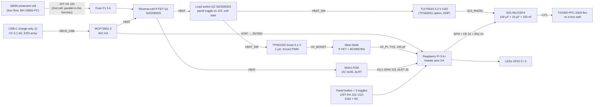

# Team C hardware — design notes (rev A – for ET review)

MTP F26 · Team C · KiCad session of 19-Oct-26 (`hw/KICAD_SESSION_PROMPT.md` v2), carrier routing finished 21-Oct-26.
Owner of the boards: **ET (Carlos,
Michele, Bikash, Guillem)**. Everything here is a proposal from the radio team unless `CLAUDE.md` says it is decided.
Fixed parts (ordered 19-Oct): **Raspberry Pi 3 Model A+**, Ebyte E01-ML01SP4, Ebyte TX2400-FPC-2509 flex antenna,
SanDisk Ultra 32 GB A1 microSD. Approved by Santiago at checkpoint 1: panel-mount controls on JST-XH leads (the power
toggle drives a P-FET), TPS61022 boost.

## Boards and files

| What | Where | State |
|---|---|---|
| SP4 breakout (bench, T0/T2) | `hw/sp4-breakout/` | **Ready for the lab**: single-sided F.Cu, 31 × 37.5 mm, ERC 0, DRC 0 (all severities), gerbers + drill + 1:1 copper PDFs (plain and mirrored) in `fab/` and `sp4-breakout_gerbers.zip` |
| Pi 3 A+ HAT carrier | `hw/teamc-carrier/` | **Rev A, routed (21-Oct), for ET review before the fab order**: schematic ERC 0/0; board DRC **0 violations, 0 unconnected, 0 schematic-parity issues** (all severities); gerbers + drill + placement + assembly PDF in `fab/`, `teamc-carrier_gerbers.zip`; 3D renders `teamc-carrier_render_{top,bottom,iso,stack}.png` |
| Project library | `hw/lib/teamc.kicad_sym`, `hw/lib/teamc.pretty/` | E01-ML01SP4 (symbol + footprint from the manual's drawing), MAX17048 (from the registry part, checked against the datasheet pinout), 2×20 socket with 1.5 mm pads |
| BoM | `hw/BOM.csv` | per device, from the netlist + off-board items; ≈ €102 (cap €150) |
| Generators | `hw/scripts/` | see below; the `.kicad_sch` files are generated: edit the sheet `.py`, not the schematic |

Scripts (run from the repo root):

| Script | Does |
|---|---|
| `build_breakout.py [--fab]` | breakout schematic → ERC → board, placement, routing, pour → DRC (→ gerbers, drill, PDFs) |
| `build_carrier.py [--sheet NAME]` | carrier sheets (`hw/teamc-carrier/sheets/*.py`) → ERC → netlist → board footprints/nets (`netlist2pcb.py`); `--sheet` builds one sheet alone for its owner |
| `place_carrier.py` | outline (template, cutouts removed), fixed placement, auto-placement of the rest, boost copper areas, GND pours, hole keep-outs |
| `route_carrier.py` | escape stubs (header edge row, SP4 pad row, fine-pitch packages), grid router (`gridroute.py`): the power path and SPI/radio, GND stitching, fill |
| `autoroute_carrier.py --java J --freerouting F [--keep power]` | the rest with **Freerouting** (Specctra DSN → SES): the kept nets go out fixed, GND (class `Ground`) is ignored, clearances padded; only the autorouted nets are merged back; GND stitching + island links. `--keep all --rip MM` = a finishing pass on what is still open |
| `finish_carrier.py [--order …]` | the last few boxed-in connections by hand + grid router (see "State of the carrier board"), ground passes (islands joined by a via or a GND track, using KiCad's own connectivity), dangling clean-up |
| `silk_carrier.py` | reference designators placed clear of pads, vias and other silk (1.0/0.8 mm); no room → F.Fab |
| `fab_carrier.py` | `fab/`: gerbers, Excellon drill + maps, placement (KiCad CSV + JLCPCB CPL, DNP left out), assembly + copper PDFs, BoM; the zip |
| `render_board.py BOARD [--with-pi] [--apply-models]` | 3D renders with bodies (top, bottom, iso, HAT on the Pi); `fetch_3d.py` fetches the stock models into `hw/.3dmodels/` (git-ignored), `teamc_lib/gen_3d.py` writes `hw/lib/teamc.3dshapes/` |
| `build_bom.py` | `hw/BOM.csv` |
| `teamc_lib/gen_fp.py`, `gen_sym.py`, `gen_socket.py` | the project library |
| `schgen.py`, `sexpr.py`, `boardutil.py`, `netlist2pcb.py` | shared: schematic writer, s-expression reader, board helpers, "update PCB from schematic" |

## Findings that changed our docs (19-Oct)

1. **The SP4 is 14.5 × 18.0 mm** (manual rev 1.7 §3 drawing p.4, photo, cdebyte.com, LCSC, EasyEDA), not 14.85: the
   spec table on p.3 is a copy-paste error ("Package DIP", "SP2" page header).
2. **SP4 pads:** 8 castellations on one 14.5 mm edge (pins 1–8, 1.27 mm, pin 1 on the right in the top view) + GND
   half-holes 9/10 on the long edges, 13.0 mm from the pad edge. Ignore the manual's §5.1 DIP-numbered figure.
   **Measure one module (14.5 mm, IPEX position ±0.5 mm) before the carrier goes to fab.**
3. **The Pi 3 A+ has no ideal diode on its 5 V input** (A+ reduced schematic rev 1.0): header pins 2/4 sit after its
   polyfuse → back-power protection on the HAT (the Pi 3B's own circuit), a fuse at the cell, and the rule
   **"HAT on: never plug the Pi's micro-USB"** (silkscreen; the boost would back-feed that supply).
4. GPIO 16 (mode MRM) is a legacy-firmware pin → 1 kΩ series resistor (part of the input network).
5. The 18650 holder (≈ 77 mm) does not fit on the 65 mm HAT → cell on the box floor, JST-VH lead.
6. TPS61088 → **TPS61022** (no KiCad symbol/registry part, datasheet 404, no stock until 2027 for the 61088).
7. Keystone 1042/1043 holders are SMT only → **MPD BH-18650-PC** (THT, for protected cells).
8. KiCad's 3D library is not installed here: `fetch_3d.py` fetches the stock models the boards use (tag 10.0.6 of
   kicad-packages3D), with substitutes for 4 that do not exist upstream (JST-VH → own model, LPS4018 → Bourns SRN4018,
   TI RWU → DFN-8 2×2, DRC0010J → VSON-10 3×3). Own VRML models: SP4, MAX17048, JST-VH, a simplified Pi 3 A+ (renders only).

## Block diagram

## Net table

Global labels between the carrier's sheets use exactly these names (`sheets/nets.py`).

| Net | What | From → to |
|---|---|---|
| `VBAT` | Cell +, after the fuse and the reverse-cell FET; charger output | J20 → F1 → Q1 → charger, fuel gauge, power switch |
| `VBAT_SW` | Switched cell | Q2 → boost input, radio LDO input |
| `5V_PI` | 5.1 V for the Pi, after the ideal diode | Q4 → header pins 2/4 |
| `3V3_RADIO` | Radio supply (never the Pi's 3V3, never the cell) | LDO → R14 (0 Ω) → SP4 pad 1 |
| `3V3_PI` | The Pi's own 3.3 V, **header pin 17 only** (pin 1 unused): pull-ups, no load | header → pull-ups |
| `VBUS_USB` | USB-C charge input | USB-C → ESD (U12) → MCP73831 VDD |
| `GND` | Ground (pours on both layers) | everywhere |
| `SPI_SCK` / `SPI_MOSI` / `SPI_MISO` | SPI0, 33 Ω series (SCK/MOSI at the Pi end, MISO at the radio end) | GPIO 11 / 10 / 9 ↔ SP4 pads 4 / 5 / 6 |
| `RADIO_CSN` / `RADIO_CE` / `RADIO_IRQ` | SPI0 CE0 / CE / IRQ (10 k pull-ups on CSN and IRQ to 3V3_PI) | GPIO 8 / 22 / 24 ↔ SP4 pads 3 / 2 / 7 |
| `I2C_SDA` / `I2C_SCL` | I2C1 (1.8 kΩ pull-ups on the Pi) | GPIO 2 / 3 ↔ MAX17048 |
| `FG_ALRT` | Fuel-gauge alert, open drain, 10 kΩ to 3V3_PI | MAX17048 → GPIO 25 |
| `BTN_TXRX`, `SW_ROLE`, `SW_MODE_NM`, `SW_MODE_MRM` | Panel inputs, active low (10 k pull-up at the connector, 1 k series, 100 nF at the GPIO, SP0504 ESD) | J10/J11/J12 → GPIO 17 / 27 / 23 / 16 |
| `LED_ACT` / `LED_STATUS` | LEDs, active high, 330 Ω | GPIO 5 / 6 |
| `CHG_STAT` | Charger status via 2N7002: 1 = charging **or** no USB, 0 = complete | → GPIO 26 |
| `UART_TX` / `UART_RX` | Console (J13, bench only, no ESD) | GPIO 14 / 15 |

## Pin map (BCM GPIO, header pin) — unchanged

Matches `proto/port/linux/ui.c` (inputs with the Pi's pull-ups, active low; role low = TX; LEDs active high;
MAX17048 at 0x36) and `radio/fw/linux/README.md` (CE pin 15, CSN = CE0 pin 24, IRQ pin 18, SPI 19/21/23); checked
against pinout.xyz by the sheet owner and by the reviewer.

| GPIO | Pin | Net | | GPIO | Pin | Net |
|---|---|---|---|---|---|---|
| 2 | 3 | I2C_SDA | | 17 | 11 | BTN_TXRX |
| 3 | 5 | I2C_SCL | | 27 | 13 | SW_ROLE |
| 14 | 8 | UART_TX | | 23 | 16 | SW_MODE_NM |
| 15 | 10 | UART_RX | | 16 | 36 | SW_MODE_MRM |
| 22 | 15 | RADIO_CE | | 5 | 29 | LED_ACT |
| 24 | 18 | RADIO_IRQ | | 6 | 31 | LED_STATUS |
| 10 | 19 | SPI_MOSI | | 25 | 22 | FG_ALRT |
| 9 | 21 | SPI_MISO | | 26 | 37 | CHG_STAT |
| 11 | 23 | SPI_SCK | | — | 2, 4 | 5V_PI |
| 8 | 24 | RADIO_CSN | | — | 17 (1 unused) | 3V3_PI |
| — | 6, 9, 14, 20, 25, 30, 34, 39 | GND | | 0 / 1 | 27 / 28 | ID_SD / ID_SC: not connected (no ID EEPROM) |

Software notes for PT: never set the MAX17048's `MODE.EnSleep`; `CHG_STAT` = 1 while charging or with no USB, 0 when
complete; GPIO 25/26 are not read yet; the LEDs glow faintly during boot (BCM default pull-ups on GPIO 5/6) — not a status.

## Power budget

Loads: Pi 3 A+ 0.3–0.5 A at 5 V in use (~0.6 A boot, ~0.8 A all cores), USB stick 0.05–0.15 A, SP4 120 mA TX / 26 mA
RX at 3.3 V. Realistic 5 V worst case ≈ 1 A. Cell current (boost η from the TPS61022 curves, + radio TX):

| 5 V load | 4.2 V | 3.6 V | 3.3 V | 3.0 V |
|---|---|---|---|---|
| 0.5 A (typical) | 0.76 A | 0.87 A | 0.94 A | 1.03 A |
| 1.0 A (realistic peak) | 1.40 A | 1.63 A | 1.78 A | **1.97 A** |
| 2.5 A (HAT-guide rating) | 3.38 A | 4.01 A | 4.46 A | 4.95 A (not reachable near 3.0 V) |

**Design point: 2 A from the cell, copper for more.** Q1 + Q2 (Si2333DDS, ≤ 40 mΩ at −2.5 V) drop ≈ 0.15 V at 2 A
(the AO3401A fallback ≈ 0.3 V and 0.6 W: rate the board at ~1 A out if it is used). Runtime on one 3000 mAh cell
(≈ 9.9 Wh usable): 2.0 W ≈ 5.0 h · 2.4 W ≈ 4.1 h · 2.8 W ≈ 3.5 h.

## Parts (carrier)

Full list with MPNs, suppliers and prices: `hw/BOM.csv`. Key parts and why:

| Ref | Part | Notes |
|---|---|---|
| J1 | Harwin M20-7832046 2×20 socket, 8.5 mm (11 mm stack), footprint `teamc:PinSocket_2x20_P2.54mm_Vertical_Pad1.5mm` | 1.5 mm pads (stock: 1.7) so the edge row can be routed at 0.3/0.3 mm and the GND pour reaches the even GND pins |
| MH1–MH4 | M2.5 NPTH Ø2.7, Ø6.2 copper-free land | Würth 970110155 nylon M2.5 × 11 F/F standoffs + screws |
| J20 | JST B2P-VH battery lead (a 2nd cell = a 2nd holder wired in parallel into the same lead) | cell in an MPD BH-18650-PC holder on the box floor |
| F1 | 5 A fast 1206 fuse (Littelfuse 0466005.NR — **verify part and stock**) | review F3: nothing else limits a short on 5V_PI |
| Q1, Q2 | Vishay Si2333DDS-T1-GE3 (AO3401A fallback, same footprint) | reverse-cell FET; P-FET load switch (gate R8 100 k to VBAT, R9 10 k to the toggle, C18 100 nF soft start) |
| J2 | GCT USB4125-GF-A-0190 USB-C, charge only | through-hole shell stakes; reachable with the lid open |
| U1 | MCP73831T-2ACI/OT, RPROG 2.21 k (452 mA) | no power path: charge with the switch OFF; expect thermal fold-back to ~250–300 mA (review F7) |
| U2, L1 | TI TPS61022RWUR + Würth 744316100 (1 µH, 11.5 A) | 750 k / 100 k → 5.10 V, 100 pF feed-forward, 22 µF in + 100 µF bulk, 3 × 22 µF out; **MODE tied to VIN (forced PWM)** — layout: MODE sits between VIN and EN; PFM would only save a few mA below ~100 mA |
| Q4, U3 | P-FET + Nexperia **BCM857BS** matched pair, 10 k mirror / 47 k gate | the Pi 3B's ideal diode |
| U4 | TI TLV75533PDBVR, 0 Ω R14 to 3V3_RADIO | U5 TPS63001 buck-boost option + R16: DNP (fit one of R14/R16) |
| U6 | MAX17048G+T10 (footprint `teamc:MAX17048_TDFN-8-1EP_2x2mm`) | on VBAT; Kelvin from Q1's source (reads ~I × RDS low under load); via in the exposed pad |
| U7 | E01-ML01SP4 (`teamc:E01-ML01SP4`) | 100 µF + 10 µF + 100 nF at pad 1; 33 Ω SPI series; CSN/IRQ pull-ups to 3V3_PI |
| U11, U12 | Littelfuse SP0504BAHTG | ESD on the four UI lines; CC1, CC2, the power-toggle line and VBUS (U12's 4th channel replaced the VBUS SMF5.0A on 19-Oct: no room at the connector, and the SMF only covered ESD anyway) |
| D2, D3 | Vishay SMF5.0A, footprint `Diode_SMD:D_SMF` | 5V_PI, VBAT (5V_PI runs slightly above VRWM: a little leakage) |
| J10–J12, J22 | JST B2B/B3B-XH-A | panel button E-Switch PS1024ABLK (Ø7.2 mm hole, drill 7.5), toggles 100SP1T1B1M1QEH (power, role) and 100SP3T1B1M1QEH (mode), Ø6.35 mm (drill 6.5) |
| J13 | 1 × 3 UART header | bench only, no ESD |
| TP1–TP3, TP10 | VBAT, 5V_PI, GND, 3V3_RADIO | wire loops |

## Board (carrier)

- **Outline:** the KiCad `RaspberryPi-HAT` template, 65 × 56 mm, R3 corners, M2.5 holes on 58 × 49 mm (matches the
  A+ drawing); the display/camera cutouts are removed (unused). The template's PoE keep-out (B.Cu) is kept: harmless on
  the A+, it also keeps parts off the PEN/RUN pads.
- **Placement (Pi coordinates):** SP4 bottom-right, IPEX near the bottom edge, ≥ 45 mm from the Pi's wireless can and
  ~30 mm from the SoC; LDO and the 100 µF/10 µF/100 nF next to SP4 pad 1. Boost (TI RWU layout: inductor above the IC,
  input cap at VIN, output caps under VOUT) and the ideal diode top-left next to header pins 2/4. Battery lead and USB-C
  on the left edge, charger and fuel gauge beside them; panel leads J22/J10/J11 on the bottom edge, J12 above them.
- **Rules (19-Oct): a JLCPCB-class 2-layer fab, not the ETSETB lab** (`boardutil.FAB_RULES`): Default net class
  0.25 mm tracks / **0.2 mm clearance**, Power 1.0 mm, vias 0.8/0.4 mm, edge 0.5 mm. Reason: under the lab-safe
  0.3 mm / 0.3–0.4 mm rules this 65 × 56 mm board does not route (rip-up and a 78-min negotiated-congestion run both
  stalled), and the carrier needs plated vias and 0.15 mm at its QFN/TDFN anyway. Package-forced exceptions: a
  0.15 mm footprint clearance on the 0.5 mm-pitch parts (TPS61022, MAX17048, USB-C, TPS63001); board minimum track
  0.2 mm, text 0.8 mm. All well inside JLCPCB's 0.1/0.1 mm. (The SP4 breakout keeps the lab-safe 0.3/0.4 mm rules.)
- **Net classes (21-Oct, `build_carrier.NET_CLASSES`):** PowerFine 0.4 mm / 0.15 mm (SW_NODE, 5V_BOOST, VBAT_SW, VBAT,
  BB_OUT/SW1/SW2: power at a fine-pitch pad), FinePitch 0.2 / 0.15 (FB, BB_VINA, FG_ALRT, I2C, CC1/CC2, VBUS_USB),
  Power 1.0 / 0.2 (5V_PI, BAT_IN, BAT_RAW), Radio3V3 0.5 (3V3_RADIO, LDO_OUT), Ground (GND: the pours), Default 0.25 /
  0.2. Until 21-Oct a `/power/*` pattern put the gate, LED and status nets of the power sheet in the 1 mm class.
- **Copper areas:** SW_NODE (inductor pad → SW pad, 0.45 mm neck at the IC), VBAT_SW (inductor input, VIN, MODE, EN)
  and 5V_BOOST (VOUT → output caps) on F.Cu above the GND pours; GND pours on both layers with stitching vias.
- **SP4:** no tracks under the module on either layer (footprint keep-out, Ebyte §4.1), GND pour + vias under it.
- **Routing, three steps** (the KiCad MCP cannot route; no autorouter is installed with KiCad here):
  1. `route_carrier.py`: the **power path** by `gridroute.py` (A* on a 0.05 mm grid, two layers) with exact escape
     stubs; widths and copper areas as designed (1.0–1.5 mm battery path, boost areas, 0.6 mm 3V3_RADIO).
  2. `autoroute_carrier.py`: everything else by **Freerouting 2.5** (portable Java 25; jar from GitHub releases). The
     power copper goes out fixed, GND is ignored (pours), the DSN clearances are padded by 10–20 µm (Freerouting rounds
     a few µm under), its neck-downs are widened back to 0.2 mm, and only the autorouted nets are merged into the board
     (its session drops fixed copper).
  3. `finish_carrier.py`: the handful of pins Freerouting could not reach (they sit inside fixed power copper), by
     hand + grid router, then the ground passes and a clean-up (next section).

### State of the carrier board on 21-Oct (rev A, for ET review)

DRC (`kicad-cli pcb drc --schematic-parity --severity-all`, report `hw/teamc-carrier/build/drc.rpt`): **0 violations
(errors and warnings), 0 unconnected items, 0 schematic-parity issues.** 696 track segments (473 top, 223 bottom,
1.67 m), 146 vias (71 GND). Fab files in `hw/teamc-carrier/fab/` (gerbers, drill, placement, assembly PDF, BoM) and
`teamc-carrier_gerbers.zip` (gerbers + drill only, for the fab's upload page; JLCPCB: 2 layers, 1.6 mm, HASL, 1 oz,
green mask, white silk). Placement for assembly: `fab/teamc-carrier-cpl-jlcpcb.csv` (DNP parts left out).

What the finishing pass did by hand (all in `finish_carrier.py`, rerunnable):
- **MAX17048 (U6) and TPS63001 (U5):** their GND pins (U6 1/4/6, U5 3/9) are tied to the exposed pad with 0.2 mm
  tracks under the package; the outward GND stubs of U6 pin 6 and U5 pins 3/9 went (they walled in U6 pin 5 and
  U5 pin 8). FG_ALRT leaves U6 pin 5 east, then to a via clear of the VBAT tracks.
- **Buck-boost option (all DNP), rerouted as a block:** L2 turned 90° and moved 0.5 mm up (TI's layout: one pad faces
  pin 2, the other pin 4); C15 turned 180° (its VOUT pad faces C14); U5 pin 10 goes straight east to R16 pin 1;
  3V3_RADIO's via between R16's pads moved onto R16 pin 2's edge (via in pad of a DNP 0R: harmless); R15 pin 1 gets a
  0.25 mm VBAT_SW feed instead of the 1 mm branch that walled R16 in (R15 only feeds VINA through 100 Ω).
- **Ground:** pours on both layers + 71 GND vias (stitching, pad anchors) + 57 short GND tracks (76 mm) that join pour
  pieces the signal tracks cut off. Connectivity is checked with KiCad's own (`GetConnectedItems`), not a model.
- **Silkscreen:** 59 references at 1.0/0.8 mm clear of copper; 26 that have no room are on F.Fab only (assembly PDF).

For ET to review in the KiCad GUI before ordering (nothing here blocks the fab, but it is your board):
1. The radio LDO's ground (U4 pin 2, C11, C12) and the area under the header's middle (J1 pins 20/25, C50–C52, J13)
   reach the main ground through short GND tracks/vias: thicken or add vias if you see a better path.
2. Thermal copper around U1 (MCP73831, review F7) is still only the pour.
3. Freerouting's tracks are correct but not pretty (detours on SW_MODE_NM_J, SW_ROLE, CHG_STAT ~ 60 mm): tidy with
   push-and-shove if you like; DRC after every change.
4. Box inside dimensions and panel-lead positions (J10–J12, J22) before freezing the outline; measure one SP4
   (14.5 mm, IPEX position) before the order.
5. Rerunning: `place_carrier.py` → `route_carrier.py` → `autoroute_carrier.py` → `finish_carrier.py` →
   `silk_carrier.py` → `fab_carrier.py`. Freerouting is not deterministic, so a rerun gives a different (equivalent)
   board, and the hand fixes in `finish_carrier.py` are tied to today's placement: check the DRC each time.

## Layout-driven changes (19-Oct, routing pass)

- **SP4 keep-out on both layers:** no tracks under the module on F.Cu *or* B.Cu (Ebyte §4.1); ground vias and both
  pours stay. The first routing had bottom-layer signals under the module.
- **Removed:** SW1 (bench button; on the bench plug the panel button into J10 or bridge its pins), J21 (2nd-cell
  connector; a 2nd cell = a 2nd holder wired in parallel into the same J20 lead), D1 (VBUS TVS → U12's spare channel).
- **TPS61022 MODE → VIN** (forced PWM; MODE sits between VIN and EN) and **header pin 1 unused** (3V3 from pin 17)
  were already in the 19-Oct version.
- Placement: functional clusters in fixed regions (`place_carrier.py` CLUSTERS), key parts pinned by hand (battery
  path J20 → F1 → Q1 → Q2, charger + USB-C below it, feedback divider beside U2, ideal diode at the header).
- Routing: grid router with rip-up and reroute (`route_carrier.py --rounds`, power and radio never ripped) or
  negotiated congestion (`--negotiate`); neither finished the small nets on this board (finished 21-Oct, below).

## Layout-driven changes (21-Oct, routing finished)

- Net classes rewritten (see "Board"): the `/power/*` pattern had put the power sheet's gate, LED and status nets in
  the 1 mm class, the main reason no router could finish the board.
- SPI and the radio control lines are now Freerouting's (the script routes were ripped with the small nets);
  lengths 7–64 mm, all on the 0.25 mm Default class with their 33 Ω series resistors in place.
- L2 turned 90° (+0.5 mm up), C15 turned 180°, 3V3_RADIO via onto R16 pin 2, GND pins of U5/U6 tied to their
  exposed pads (details in "State of the carrier board").
- Silkscreen: the bottom text reads "rev A for ET review - 21-Oct-26".

## Review (independent, 19-Oct) and what was done

| # | Severity | Finding | Done |
|---|---|---|---|
| F1 | major | AO3401A Q1/Q2: ~0.3 V / 0.6 W at 2 A from a 3 V cell | Si2333DDS (AO3401A fallback; then rate ~1 A out); Kelvin from Q1's source documented |
| F2 | minor | BC857BS lacks VBE matching | BCM857BS,115 |
| F3 | minor | nothing limits a short on 5V_PI except the cell's PCM | F1 5 A fuse at the battery lead |
| F4 | minor (suspicion) | Q2 turn-on inrush could trip the cell's PCM | R9 10 k + C18 100 nF (~1 ms soft start); bench-check with the real cell |
| F5 | minor | SMF5.0A footprint | `D_SMF` (Vishay land pattern) |
| F6 | minor | boost back-feeds a micro-USB supply on the A+ | silkscreen + operating rule |
| F7 | note | MCP73831 thermal fold-back | copper around U1 (ET), or accept ~10 h charge |
| F8 | note | charging with the switch ON never terminates; CHG_STAT 1 = charging or no USB | operating rule; add a VBUS divider to a spare GPIO if PT needs it |
| F9 | note | radio pull-ups back-feed an unpowered Pi | pull-ups moved to 3V3_PI; avoid "Pi on micro-USB, HAT off" on the bench |
| F10–F14 | note | LED boot glow, TVS leakage at 5.1 V, U3 VEBO margin (as on the Pi 3B), no hardware UVLO (software thresholds + PCM), no ESD on J13/BAT (internal) | documented |
| F15 | minor | design-notes drift | this version |

Checked correct by the reviewer: every IC pinout (symbol ↔ footprint ↔ datasheet), the netlist vs the sheet sources,
the header map vs `ui.c` / the radio README / pinout.xyz, boot states (CE low, CSN high), rails (SP4 only on
3V3_RADIO), one CPU only (MAX17048 is a fixed-function gauge), no wireless chip added.

## What the tools could not do

- The KiCad MCP cannot place, route, pour or edit footprints: all of that is `pcbnew` Python in `hw/scripts/`.
- pcbnew 10.0.6's Python bindings: `board.Remove()` (and many deletions in a row) leave the track list unusable and
  can segfault; the scripts delete with `Delete()`, a few at a time, or edit the file's segment/via blocks as text.
  The ratsnest object is not exposed; `GetConnectivity().GetConnectedItems(item)` is.
- `kicad-cli` (10.0.6) ignored a project `.kicad_dru` custom-rules file entirely, so the fine-pitch exceptions are
  footprint clearances + a net class instead of custom rules.
- No autorouter in the KiCad install: Freerouting runs from a portable Java (see "Routing"). No 3D library: fetched.

## Open questions for ET and the lab

- Lab limits (Prof. Chávez / Prof. Jiménez): minimum track/clearance (the carrier needs 0.2 mm necks and 0.15 mm at
  the QFN/TDFN), plated vias (the carrier needs them; the breakout does not), solder mask, stencil + hot air for the
  QFN/TDFN, turnaround. Else a JLCPCB-class 2-layer fab (~€1/board + 1–2 weeks).
- Stock: TPS61022 (DigiKey 0 on 19-Oct; Mouser/LCSC/TI), Si2333DDS (0 until Jan-27; AO3401A fallback), fuse part number.
- Box inside dimensions and panel-hole positions (Santiago to measure) before freezing the outline/connector edges.
- Atenea Q22 (Pi wireless chip), Q6 (foil at the USB port), Q8 (role switch).
