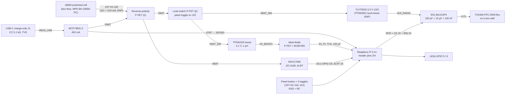

# Team C hardware — design notes (DRAFT – for ET review)

MTP F26 · Team C · started 19-Oct-26 in the KiCad session (`hw/KICAD_SESSION_PROMPT.md` v2).
Owner of the boards: **ET (Carlos, Michele, Bikash, Guillem)**. Everything here is a proposal from the radio team
unless `CLAUDE.md` says it is decided. Fixed parts (ordered 19-Oct): Raspberry Pi 3 Model A+, Ebyte E01-ML01SP4,
Ebyte TX2400-FPC-2509 flex antenna, SanDisk Ultra 32 GB A1 microSD.

## Boards

| Board | Folder | Purpose |
|---|---|---|
| SP4 breakout | `hw/sp4-breakout/` | E01-ML01SP4 → 1 × 8 2.54 mm header for the bench (T0/T2) from day one |
| Pi 3 A+ HAT carrier | `hw/teamc-carrier/` | Radio, power (boost, LDO, charger, fuel gauge), UI connectors, on the Pi's 40-pin header |
| Project library | `hw/lib/` | `teamc.kicad_sym` + `teamc.pretty/` (E01-ML01SP4 and parts missing from the KiCad libraries) |
| Generators | `hw/scripts/` | `schgen.py` (schematic from a Python parts list), `netlist2pcb.py` (board update from the netlist) |

## Findings from the research (19-Oct) that change our docs

1. **The SP4 is 14.5 × 18.0 mm**, not 14.85 × 18 (manual rev 1.7 §3 drawing p.4, photo, cdebyte.com, LCSC, EasyEDA all
   agree; only the copy-pasted spec table on p.3 says 14.85, next to "Package DIP" and an SP2 page header).
2. **The SP4 pads are 8 castellations on one 14.5 mm edge** (pins 1–8, 1.27 mm pitch, pin 1 on the right in the top
   view) **plus two GND half-holes** (pins 9 and 10) on the long edges, 13.0 mm from the pad-row edge. Signal pads
   0.80 mm wide (0.75 mm deep on top, 1.00 mm on the bottom); GND pads Ø1.5 with a Ø1.0 half-hole. "0.8 × 1.5 mm pad"
   in our docs mixed the two. The §5.1 "basic circuit" figure uses the generic DIP numbering: ignore it.
3. **The Pi 3 A+ has no ideal diode on its 5 V input** (reduced schematic rev 1.0: micro-USB → MF-MSMF260 polyfuse →
   5 V; header pins 2/4 sit after the fuse). Feeding 5 V on the header bypasses the fuse, and a micro-USB supply
   plugged in at the same time fights our boost. → **back-power protection on the HAT, rated ≥ 2.5 A** (the LM66100
   named in older docs is a 1.5 A part).
4. **GPIO 16 (mode MRM) is a legacy-firmware pin** (HAT design guide: GPIO 6/14/16 may be driven at boot): the switch
   line gets a 1 kΩ series resistor (part of the ESD/RC network anyway).
5. **The 18650 holder does not fit on the HAT** (≈ 77 mm long > 65 mm). The cell sits on the box floor beside the Pi,
   with a lead to the HAT.
6. TPS61088 (our earlier boost): no KiCad symbol, no registry record, datasheet URL 404, DigiKey 0 stock until 2027.
   → **TPS61022** (1 cell → 5 V / 3 A reference design, internal compensation, 7 pins, symbol + footprint in KiCad).
7. Keystone 1042/1043 holders are SMT only (bad for the drop test) → **MPD BH-18650-PC** (THT, made for protected
   cells).
8. KiCad 3D models are not installed on this machine (`kicad-packages3d`): renders show bare footprints.

## Block diagram

## Net table

Global labels between the carrier's sheets use exactly these names.

| Net | What | From → to |
|---|---|---|
| `VBAT` | Cell +, after the reverse-polarity FET; charger output | J20/J21 → Q1 → charger, fuel gauge, power switch |
| `VBAT_SW` | Switched cell | Q2 → boost input, radio LDO input |
| `5V_PI` | 5.1 V for the Pi, after back-power protection | ideal diode → header pins 2/4 |
| `3V3_RADIO` | Radio supply (never the Pi's 3V3, never the cell) | LDO → SP4 pad 1 |
| `3V3_PI` | The Pi's own 3.3 V (header 1/17): pull-ups only, no load | header → pull-ups |
| `VBUS_USB` | USB-C charge input (5 V) | USB-C → TVS → MCP73831 VDD |
| `GND` | Ground | everywhere |
| `SPI_SCK` / `SPI_MOSI` / `SPI_MISO` | SPI0 | GPIO 11 / 10 / 9 ↔ SP4 pads 4 / 5 / 6 |
| `RADIO_CSN` | SPI0 CE0 | GPIO 8 → SP4 pad 3 |
| `RADIO_CE` | Radio CE | GPIO 22 → SP4 pad 2 |
| `RADIO_IRQ` | Radio IRQ, active low | SP4 pad 7 → GPIO 24 |
| `I2C_SDA` / `I2C_SCL` | I2C1 (1.8 kΩ pull-ups on the Pi) | GPIO 2 / 3 ↔ MAX17048 |
| `FG_ALRT` | Fuel-gauge alert, open drain, 10 kΩ to 3V3_PI | MAX17048 → GPIO 25 |
| `BTN_TXRX` | GO/STOP button, active low | J10 → ESD/RC → GPIO 17 |
| `SW_ROLE` | Role switch, low = TX | J11 → ESD/RC → GPIO 27 |
| `SW_MODE_NM` / `SW_MODE_MRM` | Mode switch, active low; neither = SRI | J12 → ESD/RC → GPIO 23 / GPIO 16 |
| `LED_ACT` / `LED_STATUS` | LEDs, active high | GPIO 5 / 6 → 330 Ω → LED → GND |
| `CHG_STAT` | Charger status through a 2N7002: 1 = charging or no USB, 0 = charge complete | → GPIO 26 |
| `UART_TX` / `UART_RX` | Console | GPIO 14 / 15 ↔ J13 |

Local nets inside a sheet (not global): `BAT_RAW`, `PWR_G`, `5V_BOOST`, `SW_NODE`, `FB`, `ZVD_B`, `ZVD_G`, `CHG_STAT_RAW`,
`CC1`, `CC2`, `PWR_SW_J`, `<line>_J` for each UI input at its connector.

## Pin map (BCM GPIO, header pin) — unchanged from the KiCad brief

Matches `proto/port/linux/ui.c` (inputs with the Pi's internal pull-up, active low; role low = TX; LEDs active high;
MAX17048 at I2C address 0x36) and `radio/fw/linux/README.md`. GPIO 25 (ALRT) and 26 (STAT) are not read by the
software yet; their pull-ups make them safe either way.

| GPIO | Pin | Net | | GPIO | Pin | Net |
|---|---|---|---|---|---|---|
| 2 | 3 | I2C_SDA | | 17 | 11 | BTN_TXRX |
| 3 | 5 | I2C_SCL | | 27 | 13 | SW_ROLE |
| 14 | 8 | UART_TX | | 23 | 16 | SW_MODE_NM |
| 15 | 10 | UART_RX | | 16 | 36 | SW_MODE_MRM |
| 22 | 15 | RADIO_CE | | 5 | 29 | LED_ACT |
| 24 | 18 | RADIO_IRQ | | 6 | 31 | LED_STATUS |
| 10 | 19 | SPI_MOSI | | 25 | 22 | FG_ALRT |
| 9 | 21 | SPI_MISO | | 26 | 37 | CHG_STAT |
| 11 | 23 | SPI_SCK | | — | 2, 4 | 5V_PI |
| 8 | 24 | RADIO_CSN | | — | 1, 17 | 3V3_PI |
| — | 6, 9, 14, 20, 25, 30, 34, 39 | GND | | 0 / 1 | 27 / 28 | ID_SD / ID_SC: not connected (no ID EEPROM) |

Software notes for PT: never set the MAX17048's `MODE.EnSleep` (it would stop tracking while the Pi is off);
`CHG_STAT` reads 1 while charging **or** with no USB, 0 when the charge is complete.

## Power budget

Loads: Pi 3 A+ 0.3–0.5 A at 5 V in use (~0.6 A boot, ~0.8 A all cores busy), USB stick 0.05–0.15 A from the Pi's
port, SP4 120 mA TX / 26 mA RX at 3.3 V (≈ the same from the cell through the LDO). Realistic 5 V worst case ≈ 1.0 A;
the HAT guide asks for 2.5 A capability.

Cell current (boost input + 0.12 A radio TX; boost efficiency estimated from the TPS61022 curves):

| 5 V load | 4.2 V | 3.6 V | 3.3 V | 3.0 V |
|---|---|---|---|---|
| 0.5 A (typical) | 0.76 A | 0.87 A | 0.94 A | 1.03 A |
| 1.0 A (realistic peak) | 1.40 A | 1.63 A | 1.78 A | **1.97 A** |
| 2.5 A (rated) | 3.38 A | 4.01 A | 4.46 A | 4.95 A |

The 2.5 A rating is not reachable from a cell near 3.0 V (≈ 0.1 Ω of cell, protection circuit, holder springs and
FETs drops ~0.5 V, and a protected cell may trip at a few amps). **Design point: 2 A from the cell, copper for 5 A.**

Track widths (IPC-2221 external, 1 oz, ΔT 10 °C): 1 A 0.30 mm · 2 A 0.78 mm · 2.5 A 1.06 mm · 3 A 1.37 mm · 5 A 2.8 mm.
→ cell → Q1 → Q2 → boost VIN and the SW loop: pour ≥ 3 mm, at least 1.5 mm, both layers with vias;
5V_BOOST → ideal diode → header pins 2 + 4: ≥ 1.5 mm; 3V3_RADIO: 0.5 mm; signals 0.4 mm (lab-friendly).

Runtime on one 3000 mAh cell (≈ 9.9 Wh usable): 2.0 W ≈ 5.0 h · 2.4 W ≈ 4.1 h · 2.8 W ≈ 3.5 h.

## Parts (carrier) — proposal

Prices: DigiKey.de qty 1 excl. VAT, 19-Oct-26, unless noted; LCSC returned "Access Denied" and Mouser timed out for
the power parts, so re-check stock before ordering. Symbols and footprints checked to exist in the KiCad 10 libraries
(`/usr/share/kicad`) unless marked *teamc* (project library) or *registry*.

### power

| Ref | Function | MPN | KiCad symbol | KiCad footprint | Price | Notes |
|---|---|---|---|---|---|---|
| J20, J21 | Battery lead (J21 = 2nd cell in parallel, DNP) | JST B2P-VH (10 A) | Connector_Generic:Conn_01x02 | Connector_JST:JST_VH_B2P-VH_1x02_P3.96mm_Vertical | ~€0.3 | Off-board: MPD BH-18650-PC holder (€2.94, THT, 9 786 in stock) on the box floor plate, strapped |
| Q1 | Reverse-cell P-FET (D → BAT_RAW, S → VBAT, G → 10 kΩ → GND) | AO3401A (pref. Si2333DDS ≤ 40 mΩ @ −2.5 V when back in stock) | Transistor_FET:AO3401A | Package_TO_SOT_SMD:SOT-23 | €0.46 | |
| Q2 | Load switch P-FET, gate from the panel power toggle | AO3401A | Transistor_FET:AO3401A | SOT-23 | €0.46 | Toggle carries µA only (option B); body diode blocks VBAT → VBAT_SW when off |
| J22 | Power toggle lead | JST B2B-XH-A | Conn_01x02 | Connector_JST:JST_XH_B2B-XH-A_1x02_P2.50mm_Vertical | ~€0.05 | Panel toggle E-Switch 100SP1T1B1M1QEH (TME €2.32) |
| J1 | USB-C charge-only | GCT USB4125-GF-A-0190 | Connector:USB_C_Receptacle_PowerOnly_6P | Connector_USB:USB_C_Receptacle_GCT_USB4125-xx-x-0190_6P_TopMnt_Horizontal | €0.54 | 1.9 mm through-hole shell stakes (drop test); reachable with the lid open |
| R | CC1/CC2 Rd | 5.1 kΩ 1 % | Device:R | 0805 HandSolder | | |
| D1, D2, D3 | TVS on VBUS_USB, 5V_PI, VBAT | SMF5.0A | Diode:SMF5V0A | **Diode_SMD:D_SOD-123F** (not the symbol's default D_SMF) | €0.24–0.44 | VC 9.2 V > MCP73831 VDD abs. max 7 V: ESD only, not a faulty-charger guard |
| U1 | Charger | MCP73831T-2ACI/OT | Battery_Management:MCP73831-2-OT | SOT-23-5 | €0.67 | RPROG **2.21 kΩ → 452 mA** (2.0 kΩ can reach 550 mA > a USB-2 port); no power path: charge with the switch OFF |
| D4 + R | Charge LED (lit while charging) | red 0805 + 1 kΩ to VBUS | Device:LED | LED_SMD:LED_0805_2012Metric_Pad1.15x1.40mm_HandSolder | | |
| Q3 | STAT → 3.3 V level (100 kΩ gate pull-down, 10 kΩ drain pull-up to 3V3_PI) | 2N7002 | Transistor_FET:2N7002 | SOT-23 | €0.18 | STAT pushes 5 V: never straight to a GPIO |
| U2 | 5.1 V boost | **TPS61022RWUR** | Converter_DCDC:TPS61022 | Package_DFN_QFN:Texas_RWU0007A_VQFN-7_2x2mm_P0.5mm | €2.09 | **DigiKey stock 0** (check Mouser/LCSC/TI); EN → VBAT_SW, MODE → GND (PFM, no reverse current); fallback TPS61089 (in stock, KiCad-ready) |
| L1 | Boost inductor 1 µH, Isat 11.5 A | Würth 744316100 | Device:L | Inductor_SMD:L_Wuerth_HCI-5040 | €2.39 | peak 5.7 A at 3.0 V in / 2.5 A out |
| R, R, C | FB divider + feed-forward | 750 kΩ / 100 kΩ 1 % (= 5.100 V), 100 pF C0G | Device:R / C | 0805 | | |
| C | Boost CIN / COUT | 22 µF 25 V X5R 1206 (1 in, 3 out) + 100 µF 16 V electrolytic on VBAT_SW | Device:C / C_Polarized | C_1206 HandSolder / CP_Elec_6.3x5.4 | €0.4 / €0.54 | |
| Q4, U3 | Ideal diode (Pi 3B circuit): P-FET + matched PNP mirror, 47 kΩ / 10 kΩ | AO3401A (DMG2305UX in the Pi), BCM857BS | Transistor_FET:AO3401A, Transistor_BJT:BC857BS | SOT-23, SOT-363_SC-70-6 | €0.46 + €0.45 | ≈ 0.13 V drop at 2.5 A |
| C | Bulk at the header | 100 µF 16 V electrolytic + 100 nF | | CP_Elec_6.3x5.4, C_0805 | €0.54 | |
| U4 | Radio LDO | **TLV75533PDBVR** (AP2112K-3.3 drop-in) | Regulator_Linear:TLV75533PDBV | SOT-23-5 | €0.37 | ≈ 65 mV dropout @ 150 mA; COUT 1–200 µF stated (AP2112 states no max) |
| U5, L2 | Buck-boost option, **DNP**; 0 Ω links pick U4 or U5 | TPS63001DRCR + 2.2 µH | Regulator_Switching:TPS63001 | Package_SON:Texas_DRC0010J_ThermalVias | €2.41 | only if T0 shows > 2 dB less output at 3.0 V |
| U6 | Fuel gauge on VBAT (Kelvin traces to J20) | MAX17048G+T10 | *registry* `max17048` (Maxim outline 21-0168, land 90-0065) | *registry* | €4.05 (LCSC $2.17) | TDFN 2×2 0.5 mm: paste + hot air; 3 µA hibernate; no CPU (fixed-function ASIC) |
| U12 | ESD on the power-toggle line and CC1/CC2 | SP0504BAHTG | Power_Protection:SP0504BAHT | SOT-23-5 | $0.47 (LCSC) | |
| TP1–4 | VBAT, 5V_PI, 3V3_RADIO, GND | Keystone 5000/5001 or wire loop | Connector:TestPoint | TestPoint:TestPoint_Loop_D2.50mm_Drill1.0mm | ~€0.3 | |

### pi_header

| Ref | Function | MPN | Symbol | Footprint | Price | Notes |
|---|---|---|---|---|---|---|
| J30 | 2 × 20 socket, 8.5 mm (11 mm stack) | Harwin M20-7832046 | Connector_Generic:Conn_02x20_Odd_Even | Connector_PinSocket_2.54mm:PinSocket_2x20_P2.54mm_Vertical (bottom side) | ~€3.5 | as in the template |
| MH1–4 | M2.5 holes, NPTH Ø2.7, Ø6.2 copper-free | — | Mechanical:MountingHole | MountingHole:MountingHole_2.7mm_M2.5 | — | Standoffs Würth 970110155 (nylon F/F M2.5 × 11) × 4 + screws |
| J13 | UART console (1 GND, 2 TX, 3 RX) | 1 × 3 pin header | Conn_01x03 | PinHeader_1x03_P2.54mm_Vertical | €0.1 | |

No ID EEPROM (only needed to call the board a "HAT"); pins 27/28 not connected. HAT display/camera cutouts omitted.

### radio

| Ref | Function | MPN | Symbol | Footprint | Price | Notes |
|---|---|---|---|---|---|---|
| U7 | Radio | Ebyte E01-ML01SP4 | *teamc* E01-ML01SP4 | *teamc* E01-ML01SP4 (from the manual's drawing, hand-solder lands) | ordered | |
| C | 100 µF + 10 µF + 100 nF at pad 1 | electrolytic 6.3 × 5.4 + X5R 0805 + X7R 0805 | | | | 110 µF total, within the LDO's 200 µF |
| R | CSN and IRQ pull-ups 10 kΩ to 3V3_RADIO | | | 0805 | | CSN high while the Pi boots |
| R | 33 Ω series on SCK, MOSI (Pi end) and MISO (radio end) | | | 0805 | | 30–40 mm lines, cheap ringing control |
| TP | 3V3_RADIO at the module | | | | | |

### ui

| Ref | Function | MPN | Symbol | Footprint | Price | Notes |
|---|---|---|---|---|---|---|
| J10 | GO/STOP button lead | B2B-XH-A | Conn_01x02 | JST_XH_B2B-XH-A_1x02_P2.50mm_Vertical | €0.05 | Panel button E-Switch PS1024ABLK (TME €1.17, Ø7.2 mm hole) |
| SW1 | Bench button in parallel with J10, DNP in the box | Omron B3F-1000 | Switch:SW_Push | Button_Switch_THT:SW_PUSH_6mm | €0.2 | |
| J11 | Role toggle lead (may stay unfitted, Q8) | B2B-XH-A | Conn_01x02 | as J10 | | E-Switch 100SP1T1B1M1QEH (TME €2.32) |
| J12 | Mode toggle lead: 1 NM, 2 GND, 3 MRM | B3B-XH-A | Conn_01x03 | JST_XH_B3B-XH-A_1x03_P2.50mm_Vertical | | E-Switch 100SP3T1B1M1QEH ON-OFF-ON (TME €2.89) |
| U11 | ESD, 4 lines, 1 nA leakage | SP0504BAHTG | Power_Protection:SP0504BAHT | SOT-23-5 | $0.47 | at the connectors |
| R, R, C × 4 | 10 kΩ pull-up to 3V3_PI at the connector, 1 kΩ series, 100 nF at the GPIO | | | 0805 | | overrides the BCM boot pull-downs; 1 kΩ also covers GPIO 16 |
| D10, D11 | Activity (green) and status (red) LEDs + 330 Ω | Würth 150080VS75000 / 150080RS75000 | Device:LED | LED_SMD:LED_0805_2012Metric | €0.2 | ≈ 4 mA from 3.3 V; no InGaN (Vf too high) |

## Placement plan (Pi coordinates, origin bottom-left, header along the top edge)

- **SP4 bottom-right** (x ≈ 44–58.5, y ≈ 2–20): ≥ 45 mm from the Pi's wireless can (top-left), 25–30 mm from the
  SoC; pad row towards the header, IPEX end towards the bottom edge for the antenna cable; LDO and its caps beside it.
  Clear of the (61.5, 3.5) hole's Ø6.2 keep-out. GND pour on both layers under it, no tracks on top under it.
- **Boost, inductor and ideal diode top-left** next to header pins 2/4 (x ≈ 3–22, y ≈ 32–48), the far corner from
  the SP4.
- **USB-C and the battery connector on the left edge** (over the Pi's display connector), charger and MAX17048 next to
  them (Kelvin traces from J20).
- **JST-XH UI connectors along the bottom edge** between the boost and the radio, ESD array at the connectors, LEDs
  at the bottom edge.
- Pi's USB-A (stick) sits under the HAT's right edge (Z 7 mm vs the HAT's 11 mm underside): nothing on the HAT bottom
  there; clip THT leads to ≤ 2.5 mm.
- Height: Pi + 11 mm stack + HAT + tallest part ≈ 24–28 mm (inductor/JST/electrolytics ≤ 6 mm).

## Open questions for ET and the lab

- Boost: TPS61022 stock (DigiKey 0) → Mouser / LCSC / TI store, else TPS61089 (values in the research notes).
- Two QFN-type parts (TPS61022 2 × 2 mm, MAX17048 2 × 2 mm): stencil + paste + hot air/hot plate in the lab, or a
  JLCPCB-class fab with assembly of those two only.
- P-FETs: AO3401A everywhere for availability; Si2333DDS (lower Rds at low VGS) when stock returns.
- Lab rules (Prof. Chávez / Prof. Jiménez): minimum track/clearance, plated vias, solder mask, turnaround.
- Box inside dimensions (Santiago to measure) before freezing the outline and the panel-hole positions.
