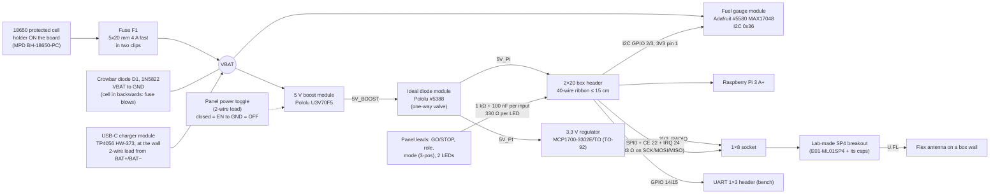

# Carrier rev C ("simple") — concept for checkpoint 1

Team C, MTP F26 · 23-Oct-26 · **approved by Santiago at checkpoint 1 (24-Oct), see "Checkpoint 1 decisions" at the end**
(brief: `hw/REVC_SIMPLE_PROMPT.md`). Rev A (`hw/teamc-carrier/`), rev B (`hw/teamc-carrier-lab/`)
and the SP4 breakout (`hw/sp4-breakout/`) are untouched.

## In one paragraph

One board per box, milled at the UPC lab on **one copper layer**. Everything on it is a ready-made module or a
through-hole part that you can solder with a normal iron. The cell sits **in a holder soldered on the board**, so
there is no battery lead. A Pololu module turns the cell into **5 V for the Pi** (through a 40-wire ribbon); a small
3-legged regulator turns that 5 V into **3.3 V for the radio**, so the radio is only on when the Pi is on. The radio is
the **lab-made SP4 breakout plugged into a 1×8 socket** (decided). An Adafruit module tells the Pi the battery level
over I2C. The panel switch only **tells the 5 V module to sleep**: it never carries the battery current. A USB-C
charger module sits at the box wall on a 2-wire lead. **No GPIO changes are needed** — the software stays as it is.

## Block diagram

## The blocks: what, why, where to buy

Stock/prices checked 23-Oct-26 (read from the shop page unless "est."). **Re-check before paying.**

| Block | Part | Why this is the simple choice | Stock 23-Oct / price | Footprint · 3D model |
|---|---|---|---|---|
| (a) 5 V for the Pi | **Pololu U3V70F5** (#2891) — same as rev B | ≈ 3.0 A out at 3.0 V in (Pololu graph), 3× our 1 A peak; true shutdown on EN (output off, not "cell passes through"); reverse-protected input; only 0.6 mA when on. The cheaper U3V40F5 has no true shutdown and no reverse protection; the S13V30F5 idles at 10–20 mA | Botland "in stock" (rev B saw 39) · €18.90 · [link](https://botland.store/converters-step-up/14003-step-up-voltage-regulator-u3v70f5-5v-10a-pololu-2891-5904422342333.html) | rev B's `teamc:Pololu_U3V70F5_Headers` (from Pololu's drill DXF) · Pololu STEP |
| (f) back-power | **Pololu ideal diode #5388** (recommended) — or a written rule only (Q4) | One-way valve on the 5 V: if someone plugs the Pi's micro-USB while the box is on (likely during development), nothing flows back into the boost or the cell. Pololu does not publish the boost's circuit, so "it is probably fine" is not provable. < 3 mΩ, no pins to configure | Botland €5.90 (page shows conflicting stock text; rev B saw 25) · [link](https://botland.store/protection-modules/29437-pololu-reverse-voltage-protector-with-ideal-diode-function-4-60v-20a-pololu-5388.html); Pololu direct $6.49 | rev B's `teamc:Pololu_IdealDiode_5388_Headers` · Pololu STEP |
| (b) 3.3 V for the radio | **MCP1700-3302E/TO** (TO-92, 3 legs) **fed from 5V_PI**, 1 µF ceramic in and out | Always exactly 3.3 V (from the cell it would sag to ≈ 2.9 V at a 3.0 V cell and the PA power with it); on only when the Pi's 5 V is on, so the radio can never back-power a switched-off Pi through its pins; no enable wiring. Costs ≈ 1–2 % more battery; 0.22 W at TX peak is fine for a TO-92 | TME 1214 pcs · ≈ €0.40 est. · [link](https://www.tme.eu/en/details/mcp1700-3302e_to/ldo-voltage-regulators-unregulated/microchip-technology/) (fallback MCP1702-3302E/TO) | stock `Package_TO_SOT_THT:TO-92_Inline` · stock 3D |
| (c) charger | **TP4056 USB-C module with protection (HW-373)** at the box wall, its BAT+/BAT− to a 2-pin JST-XH on VBAT (after the fuse) | Off-board where the USB-C is reachable; 1 A = 0.33 C for a 3000 mAh cell (~3.5 h). Wired to BAT+/BAT−, not OUT+/OUT−, so the box current never goes through its little protection FETs; the cell has its own protection. Rule: **charge with the box OFF**. Many of these boards lack USB-C CC resistors → **use a USB-A-to-C cable** | Botland "in stock" (rev B saw 319) · €1.00 · [link](https://botland.store/li-ion-battery-chargers/16979-li-ion-charger-hw-373-v121-tp4056-1s-37v-usb-type-c-with-protection-5904422326708.html). Alternative: Adafruit #4410 (0.5 A, documented), DigiKey.es €6.32, 966 pcs | lead only: stock `JST_XH_B2B-XH-A` (lab copy with 2.0 mm pads exists) · stock 3D |
| (d) battery level | **Adafruit MAX17048 #5580** — same as rev B, verified | Same chip and address (0x36) as the software expects; chip runs from the cell, its VIN (= the Pi's 3.3 V, pin 1) only feeds the I2C pull-ups | Kiwi 41 pcs · €6.88 · [link](https://www.kiwi-electronics.com/en/adafruit-max17048-lipoly-liion-fuel-gauge-battery-monitor-11061) | rev B's `teamc:Adafruit_MAX17048_5580_Headers` (from Adafruit's Eagle file) · generated box model |
| (e) fuse | **5×20 mm 4 A fast ceramic fuse (Littelfuse 0216004.MXP) in two Keystone 3517 clips** (changed at checkpoint 1 from the axial 0251004.MRT1L) | Replaceable by hand without soldering after a reversed cell; opens in milliseconds on a short; 4 A keeps margin over the 1.8 A drawn at a 3.0 V cell; a spare fuse is in the BoM | DigiKey.es 4517 pcs · €1.85; clips TME 2170 pcs · $0.31 | stock `Fuse:Fuseholder_Clip-5x20mm_Keystone_3517…` (pads 2.7 on 1.7 = hole + 1.0) · stock 3D |
| (e) reverse cell | **1N5822** Schottky (THT) across VBAT after the fuse ("crowbar") | An open holder accepts a cell either way round. Backwards, this diode shorts it, so the fuse blows or the cell's own protection cuts — no part sees a large reverse voltage. No voltage drop in normal use (unlike a series diode, ≈ 0.4 V). Simpler to understand than rev B's P-FET | TME 221 pcs · $0.26 · [link](https://www.tme.eu/en/details/1n5822-st/tht-schottky-diodes/stmicroelectronics/1n5822/) | stock `Diode_THT:D_DO-201AD_P15.24mm_Horizontal` · stock 3D |
| (e) power switch | **Panel toggle on a 2-pin lead between the boost's EN pin and GND** (closed = OFF) | The switch carries microamps, not 2 A: no voltage drop, no inrush, no current rating to worry about. A lead that breaks in the drop test leaves the box **running** (the boost's own 100 kΩ pull-up), which is the better failure in a competition. Off-drain ≈ 40 µA (pull-up) + 23 µA (gauge): years | E-Switch 100SP1T1B1M1QEH (TME, rev B) · ≈ €2.32 | stock `JST_XH_B2B-XH-A` lead |
| cell + holder | **MPD BH-18650-PC** soldered on the board + one protected 18650 ≥ 3000 mAh (Keeppower P1835J 3500 mAh or Nitecore NL1835) | No battery lead or connector to mis-wire; a cable tie around cell and board for the drop test | holder DigiKey.es 9726 pcs · €2.94 · [link](https://www.digikey.es/en/products/detail/mpd-memory-protection-devices/BH-18650-PC/3029216); cell ≈ €8–10 (EU stock not confirmed) | stock `Battery:BatteryHolder_MPD_BH-18650-PC` · stock 3D (to confirm) |
| (g) Pi link | **2×20 shrouded box header** + **40-wire female-female ribbon, 15 cm** | Keyed, cannot go in rotated; no soldering on the Pi; the Pi can be unplugged for development. **All 8 GND pins tied** to the carrier ground. 15 cm is the shortest found in stock (10 cm not found in the EU) | header ≈ €0.60 est.; ribbon Botland in stock · €1.90 · [link](https://botland.store/idc-cables-and-connectors/3618-cable-idc-40-pin-female-female-15-cm-raspberry-pi-32-b.html) | rev B's lab copy `teamc:IDC-Header_2x20_P2.54mm_Vertical_Pad2.0mm` · stock 3D |
| (g) radio | **1×8 female socket** for the SP4 breakout + M3 standoff at its H1 (decided) | as rev B: the carrier gives the socket, 3.3 V and the SPI/CE/IRQ wiring | ≈ €0.40 est. | rev B's `teamc:PinSocket_1x08_P2.54mm_Vertical_Pad2.0mm` · stock 3D |
| (h) panel leads | JST-XH: GO/STOP (2), role (2), mode (3), **LEDs (3: ACT, STATUS, GND)**, power (2), charger (2); **1 kΩ axial in series + 100 nF to GND** per input; **330 Ω** per LED; 5 mm LEDs in panel clips | The Pi's own pull-ups (ui.c already requests them) — no pull-up resistors; 1 kΩ + 100 nF protect the GPIO from a zap on the switch lever. No TVS diodes (SMD only; rev B had 6) | resistors/caps/LEDs/headers: generic, TME est. | stock `Resistor_THT:R_Axial_DIN0207…P10.16mm`, `Capacitor_THT`, JST XH lab copies · stock 3D |
| bench | UART 1×3 header (GND, TX, RX); **test loops** on VBAT, 5V_PI, 3V3_RADIO, GND | something to clip a multimeter on for every rail | Keystone 5010 est. | stock `TestPoint_Keystone_5010-5014_Multipurpose` · stock 3D |

Not on rev C (vs rev B): the 2N7002 inverter, the SMD P-FET, all SMD resistors/capacitors/TVS, the SMD LDO, the battery
JST-VH lead. SMD parts left on the board: **none planned**.

## Board concept

- **One copper layer + a few insulated wire links**, same lab process as rev B. Why not two layers: the lab has no
  plated holes, so a top-layer track only connects through a wire soldered on both sides, and a through-hole pin under a
  connector body cannot be soldered on top at all — that is more work and harder to check than a visible wire link.
- **Why rev B needed 10 wire links and rev C should need about 2–4:** I checked the Pi header's pin order around the
  connector. Only one radio wire is forced to cross another (IRQ: it sits on the other row from MISO, which it must land
  next to). The rest of rev B's links came from a "pocket": the SPI wires plus the socket enclose the header pins 25–40
  (four GND pins, the LED pins, mode MRM). On rev C the **33 Ω resistors on SCK/MOSI/MISO are through-hole parts with
  10 mm between their legs**: a ground track or a signal can pass between the legs, which opens the pocket without a
  wire. Each such crossing will be written on the board drawing ("the IRQ track passes under R7"). Bigger board = no
  cramped areas, so all 8 header GND pins can reach the ground pour.
- **No GPIO change** (CE 22, CSN 8, IRQ 24, SPI 9/10/11, I2C 2/3, button 17, role 27, NM 23, MRM 16, LEDs 5/6, UART
  14/15). FG_ALRT (GPIO 25) stays unconnected: the software polls the gauge.
- **Size and placement (default, see `concept_floorplan.png`):** carrier ≈ **120 × 63 mm** along one wall of the box
  floor (fits a 160 × 100 mm lab blank), the Pi on the floor beside it with its header edge facing the carrier's box
  header (15 cm ribbon, folded). On the carrier: SP4 breakout at the antenna end, power modules in the middle, cell
  holder along the long edge, all lead connectors on the panel-wall edge. Nothing stacked, every module pin reachable
  with a multimeter probe.
- Tracks 0.8–1.0 mm for signals, 1.5–2 mm for power, pads = hole + 1.0 mm, test loops on every rail, M3 holes in the
  corners.

## Power budget (U3V70F5 + MCP1700 from 5 V)

Cell current (Pololu efficiency graph; 3.0 V extrapolated): 0.5 A at 5 V → 0.62 / 0.73 / 0.90 A at a 4.2 / 3.6 / 3.0 V
cell; 1.0 A at 5 V → 1.24 / 1.46 / 1.81 A. Radio adds ≈ 0.04 A (RX) to 0.18 A (TX peak). **Runtime on 3000 mAh:
≈ 3.5–3.9 h at a 0.5 A Pi, ≈ 4.5 h at 0.4 A** — the 4 h goal holds only if the Pi averages ≈ 0.4 A (measure it).

## Draft BoM (per box, EUR, incl. VAT where known)

| Item | EUR |
|---|---|
| Pololu U3V70F5 boost | 18.90 |
| Pololu #5388 ideal diode (recommended, Q4) | 5.90 |
| Adafruit #5580 fuel gauge | 6.88 |
| MCP1700-3302E/TO, 5×20 fuse + 2 clips, 1N5822 | 1.75 |
| BH-18650-PC holder | 2.94 |
| 2×20 box header, 1×8 socket, 6 JST-XH headers + housings/crimps, 1×3 header, male strip | 2.35 |
| ~10 axial resistors, 2 × 100 µF, 2 × 1 µF, 5 × 100 nF, 4 test loops (est.) | 3.00 |
| Carrier PCB, UPC lab (rules: counts €15) | 15.00 |
| **Carrier subtotal** | **≈ 56.7** |
| Raspberry Pi 3 A+ (bought) + microSD | 33.00 |
| SP4 + flex antenna (bought) + SP4 breakout (lab PCB + parts) | 19.60 |
| TP4056 HW-373, 15 cm ribbon, protected 18650 (est. €9) | 11.90 |
| Panel: GO/STOP button, power + role toggles, mode toggle, 2 LEDs + clips | 9.50 |
| Box, standoffs (M3 + M2.5), wire, glue, solder | 8.40 |
| **Total per box** | **≈ 139 (cap 150)**; without the #5388 ≈ 133 |

Superseded at checkpoint 2 by `hw/BOM_revC.csv` (supplier links, stock as read, footprints, 3D sources): ≈ €145 per box excl. VAT, with every price excl. VAT (the Pi too) and qty-10 price breaks for the 3-box order.

## Risks to measure on the bench

1. **5 V at the Pi ≥ 4.75 V at 1 A.** The U3V70F5 is 5.0 V ± 4 % (worst case 4.8 V) and the ribbon drops a little more.
   Measure on the Pi's 5 V pin under load; if low: shorter ribbon, or the adjustable U3V70A set to 5.15 V with a meter.
2. 3.3 V ripple at the radio during TX (boost switching at ~hundreds of kHz); the breakout's 100 µF + 10 µF should cover it.
3. Fuse survives switch-on and boot; a reversed cell trips the fuse or the cell's PCM (test with a current-limited supply
   before fitting modules).
4. Cell length (protected cells 67–71 mm) against the holder; TP4056 board size; ribbon pin 1 to pin 1 (continuity).

## Sources

Research by subagents on 23-Oct (Pololu product pages and graphs; Kiwi, Botland, TME, DigiKey product pages; IKEA
pages give only outside dimensions). E01-ML01SP4 supply 2.0–3.6 V (Ebyte manual). MCP1700 dropout 178 mV typ at 250 mA
(Microchip datasheet). Pictures: `concept_block_diagram.png` (the diagram above), `concept_floorplan.png` (sketch).

## Questions for Santiago (checkpoint 1; recommended option first)

1. **Box inside dimensions** (IKEA 365+ plastic 750 ml, 15 × 15 × 7 cm outside; IKEA publishes no inside size and the
   walls may taper): floor length × width **at the bottom**, inside height with the lid on. Default if unknown:
   125 × 125 mm floor, ≥ 55 mm height.
2. **What goes where.** Default: cell holder on the carrier; carrier along one wall, Pi beside it on the floor; flex
   antenna high on the opposite wall; panel wall = power toggle, GO/STOP, role, mode, 2 LEDs, USB-C charger, and the
   Pi's USB-A port facing it for the stick. Alternative: cell holder on the floor with a JST-VH lead (smaller carrier).
3. **Largest lab blank** (is 160 × 100 mm the limit?) — the default carrier is ≈ 120 × 63 mm.
4. **Back-power:** keep the Pololu #5388 ideal diode (+€5.90, recommended) / drop it and rely on the rule "never plug
   the Pi's micro-USB while the box is on".
5. **Power switch:** toggle on the boost's EN (no battery current in the switch; broken lead = box stays on;
   recommended) / toggle in series with the battery current (broken lead = box off; needs a ≥ 3 A DC switch and lead).
6. **Reverse cell:** 1N5822 crowbar + 4 A fuse (recommended) / rev B's SOT-23 P-FET (the only SMD part) / nothing.
7. **GPIOs:** none changed (confirm).

## Checkpoint 1 decisions (Santiago, 24-Oct-26)

All the recommended options:
1. Box inside dimensions and the lab's largest blank: not known yet — keep the defaults (125 × 125 mm floor, ≥ 55 mm
   inside height, board within 160 × 100 mm); ask again at checkpoint 2, before the layout.
2. Cell holder ON the carrier; carrier ≈ 120 × 63 mm along one wall; the Pi on the floor beside it; antenna high on the
   opposite wall; one panel wall with the toggles, LEDs, USB-C charger and the Pi's USB-A.
3. Keep the Pololu #5388 ideal diode.
4. Power toggle on the boost's ENABLE (sleep, fail-on).
5. 1N5822 across the cell + 4 A fuse. The fuse is what blows on a reversed cell, so it must be easy to replace: rev C
   uses a 5×20 mm fuse in two clips (pull out, push in), with a spare in the BoM.
6. No GPIO changes.
Also: slots for a strap / cable tie over the 18650 in its holder (drop test); bench check of the 1N5822 leakage.

## After checkpoint 3 (Santiago, 24-Oct-26)

Layout and the 4 wire links accepted, with two fixes: **P4KE10A through-hole TVS diodes** (DO-41, standing) at each
panel-lead connector (D12–D15 on the inputs, D16 on the power-toggle lead) — so rev C does have TVS protection after
all, not only the 1 kΩ — and **low wire-loop test points** for TP2/TP3/TP4 (a Keystone 5010 is too tall under the
breakout). To fit them the board grew to **120 × 68 mm**. Build guide: `hw/REVC_GUIDE.md`.
